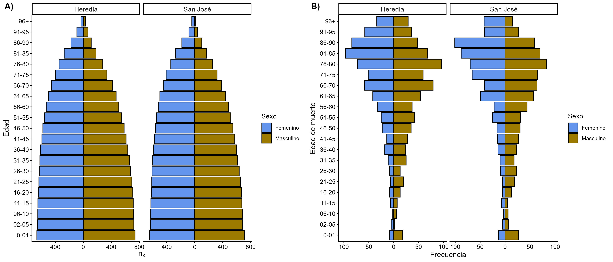

## En esta primer práctica abordamos un estudio demográfico para construir y comparar tablas de vida y curvas de supervivencia a partir de registros funerarios de cementerios en las provincias de Heredia y San José. El objetivo fue caracterizar los patrones de mortalidad humana (evaluando los modelos teóricos Tipo I, II y III) y determinar si existían diferencias estadísticamente significativas en las distribuciones de edades de muerte entre ambas localidades y según el sexo. Durante el procedimiento, realizamos una recolecta sistemática manual de datos en lápidas utilizando la aplicación móvil Epicollect 5 —registrando sexo, año de nacimiento y año de defunción— para conformar una base de datos conjunta de 2,763 individuos que posteriormente analizamos y graficamos en R. La discusión de los resultados evidenció que ambas poblaciones se ajustan claramente a una curva de supervivencia Tipo I, con altas tasas de supervivencia en edades tempranas y un aumento drástico de la mortalidad después de los 50-60 años. Asimismo, se observó una mayor longevidad en las mujeres (mediana de 77 años) en comparación con los hombres (mediana de 68 años), aunque no se detectaron diferencias significativas entre las provincias (ambas con una mediana general de 72 años), lo que refleja condiciones de salud pública y dinámicas socioambientales muy similares en el Gran Área Metropolitana. En esta práctica aprendí a recopilar datos históricos en campo mediante herramientas digitales, a construir pirámides poblacionales y a interpretar curvas de supervivencia para entender la estructura de mortalidad en poblaciones humanas.  

Figura 1. Piramides de vida obtenidas a partir de los datos recolectados en el Cementerio general de San Jose
