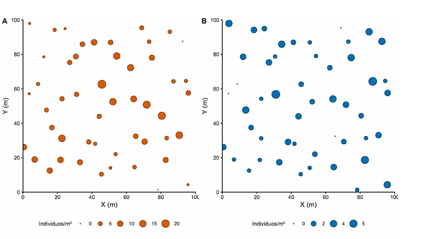
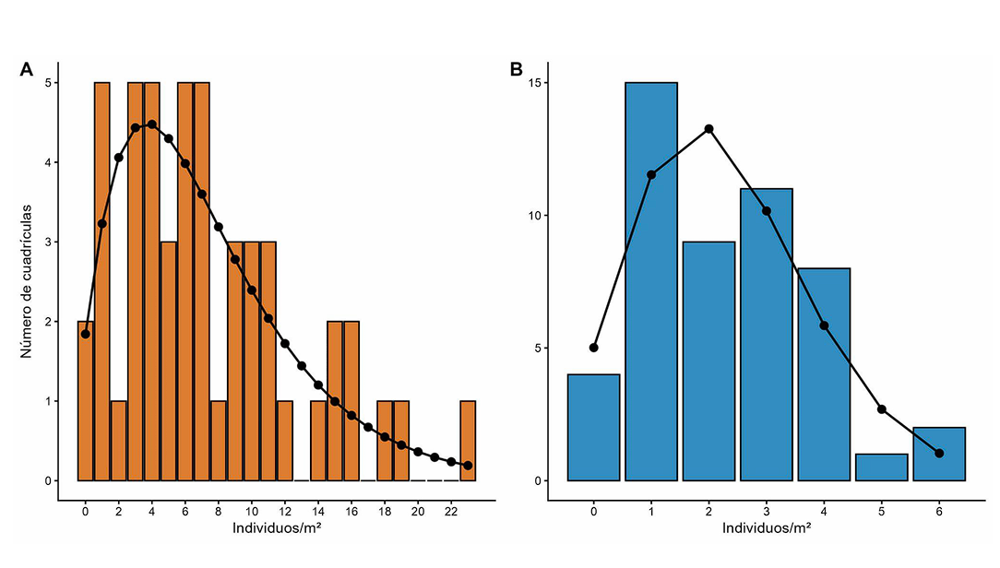

## En esta práctica de campo realizada en el Parque Recreativo de la Universidad para la Paz (El Rodeo, Mora), el objetivo principal consistió en evaluar y comparar los patrones de distribución espacial de dos especies vegetales con hábitos de crecimiento contrastantes: *Elephantopus mollis* (escobilla) y *Rhynchospora nervosa* (pasto estrella). Como procedimiento metodológico, delimitamos una hectárea (100x100 m) dividida en sectores, dentro de la cual establecimos aleatoriamente 50 cuadrículas de 1x1m. En cada unidad de muestreo realizamos el conteo manual de los individuos de ambas especies, para luego procesar los datos en RStudio utilizando índices de dispersión (varianza/media) y pruebas de Chi-cuadrado de bondad de ajuste con modelos probabilísticos (binomial negativa y Poisson). Al discutir los resultados, comprobamos que *Elephantopus mollis* presenta una distribución agregada (índice de dispersión de 3.91) asociada a su crecimiento en rosetas densas y exclusión competitiva, mientras que *Rhynchospora nervosa* mostró un patrón aleatorio (índice de dispersión de 0.98) vinculado a su propagación por rizomas y mayor plasticidad para explorar el entorno. En esta práctica aprendí a aplicar técnicas de muestreo por cuadrantes en el campo y a utilizar herramientas estadísticas en R para diferenciar y modelar matemáticamente los patrones de distribución espacial de las plantas. 

Figura 1. Evidencia de la distribución espacial obtenida del set de datos de la gira.

Figura 2. Evidencia obtenida de el número de individuos según el número de cuadrículas obtenidos a partir del set de datos de la gira II.
