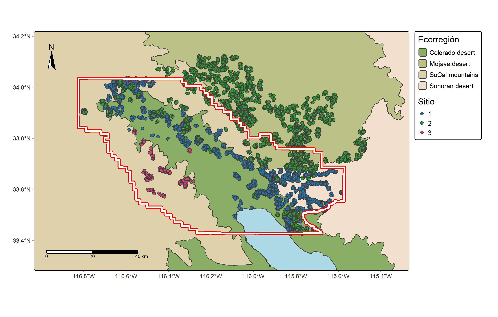
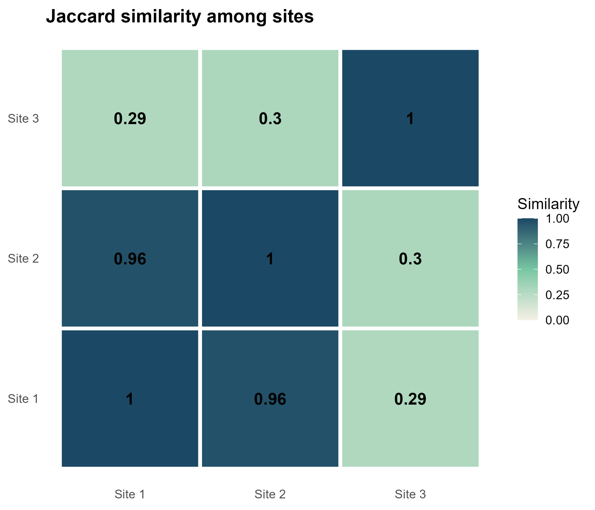
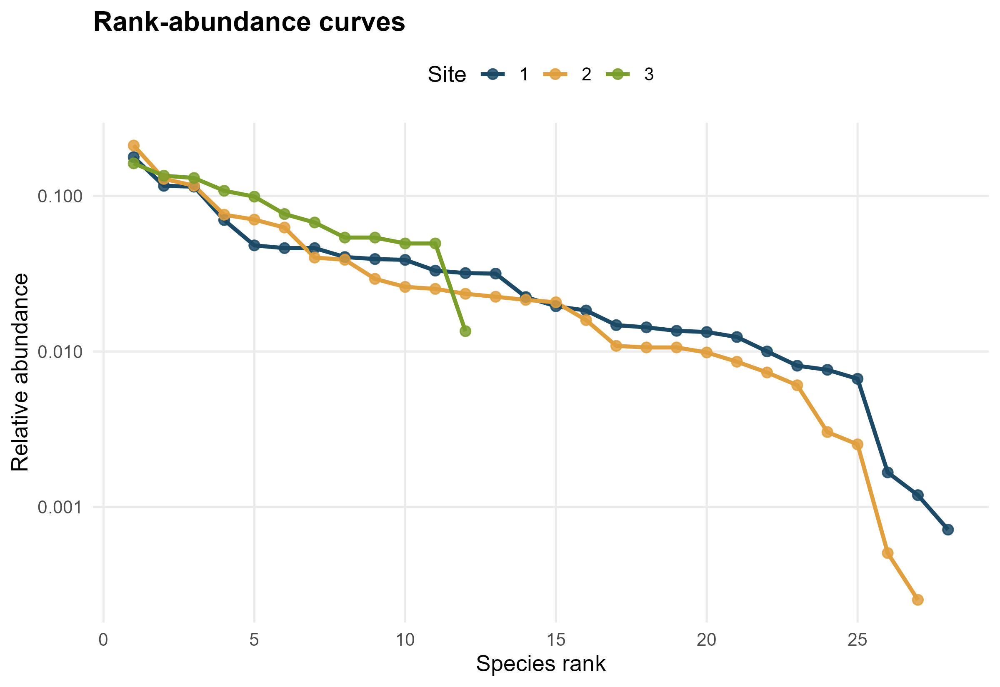

# Práctica de índices de diversidad

En la quinta práctica cambiamos de grupo biológico para analizar comunidades de plantas en tres sitios distintos ubicados entre ecorregiones desérticas y montañosas. El objetivo fue medir qué tan diversas son estas comunidades y cuánto se parecen entre sí. Mediante el análisis de datos de muestreo, construimos curvas de rango-abundancia para ver qué especies dominan en cada lugar y calculamos el índice de similitud de Jaccard. Los resultados mostraron un contraste muy claro: el Sitio 1 y el Sitio 2 son prácticamente iguales en su composición de especies (similitud de 0.96), mientras que el Sitio 3 es muy diferente a ambos (similitud de 0.29 y 0.30), evidenciando un fuerte recambio de vegetación debido a las condiciones de su ecorregión. En esta práctica aprendí a interpretar gráficas de diversidad y matrices de similitud para comparar comunidades ecológicas y entender cómo cambia la flora entre distintos ambientes.

Figura 1. Distribución de plantas según ecorregión y sitio

Figura 2. Indice de jaccard obtenido entre sitios.

Figura 3. Grafico de rango de abundancia obtenido en la práctica.
