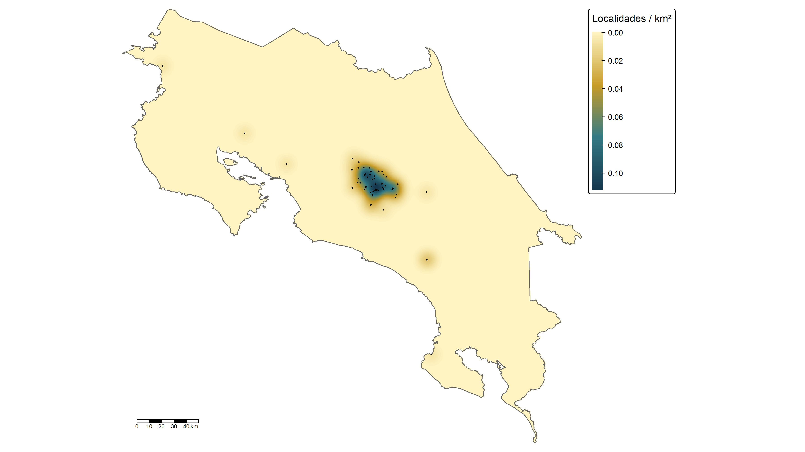
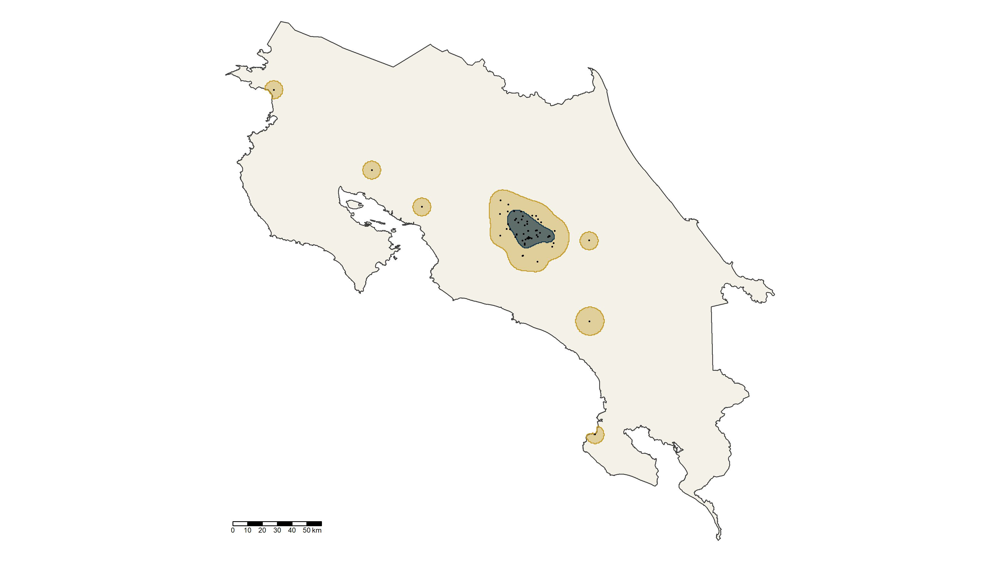

## En esta cuarta práctica aplicamos la herramienta de Estimación de Densidad Kernel (KDE) sobre los puntos de *Latrodectus geometricus* para identificar sus zonas de mayor concentración. El objetivo fue encontrar el nivel de suavizado adecuado que representara de forma realista cómo se agrupa la especie en el espacio. Durante el procedimiento generamos varios mapas experimentales, probando distintos valores del parámetro de radio (*sigma*) desde 100 hasta 10,000. Al comparar los resultados, discutimos cómo los valores muy bajos de *sigma* crean puntos aislados muy pequeños, mientras que los valores muy altos exageran el suavizado y borran los detalles locales importantes. En esta práctica aprendí a calibrar parámetros espaciales en análisis de densidad y a evaluar visualmente qué escala de suavizado se ajusta mejor al comportamiento real de una especie.

Figura 1.Mapa generado apartir de la práctica de KDE escala sigma de 10000.

Figura 2.Mapa generado apartir de la práctica de KDE escala sigma de 5000.
